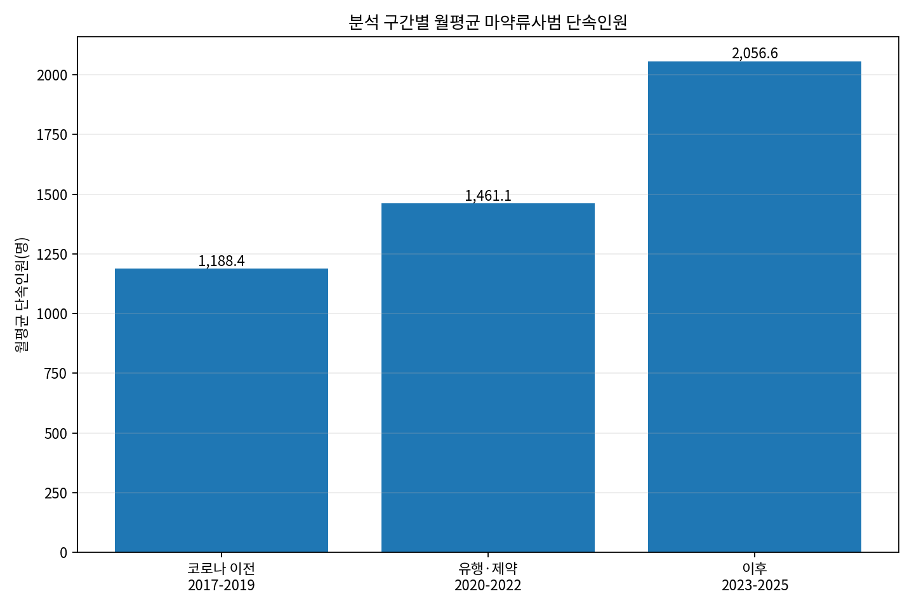
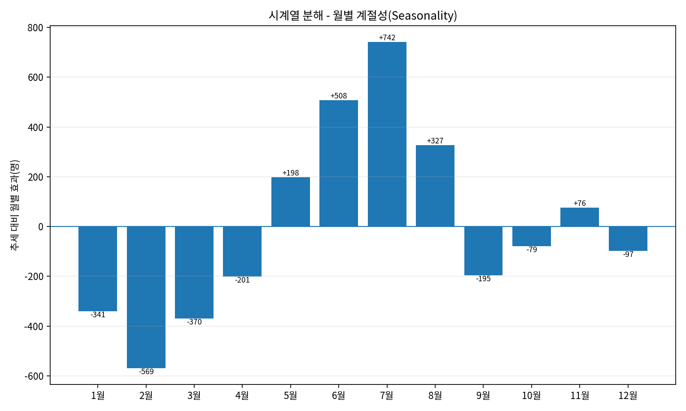

# 코로나19 전후 국내 마약류사범 단속 추이와 범죄 유형 변화 분석

> 대검찰청 월별 마약류 통계자료 108개월을 정제·분석하여 장기 추세, 변화율, 범죄 유형 구성, 마약류 종류별 변화와 계절성 후보를 확인한 데이터 분석 프로젝트입니다.

## 바로 보기

- **상세 분석 보고서:** [REPORT.md](./REPORT.md)
- **데이터 추출·검증 기록:** [DATA_EXTRACTION_NOTES.md](./DATA_EXTRACTION_NOTES.md)
- **과제 안내 + 제출 부록 PDF:** [AI 데이터 분석 과제 제출본](./output/pdf/AI_데이터_분석_과제_제출본.pdf)
- **Dashboard:** [`dashboard/index.html`](./dashboard/index.html)
- **GitHub Pages 배포용 정적 파일:** [`docs/`](./docs/)

## 1. 프로젝트 개요

- 분석 기간: **2017-01 ~ 2025-12**
- 핵심 시계열: **108개월 / 108개 데이터 포인트**
- 원 출처: **대검찰청**
- 게시 자료: 한국마약퇴치운동본부 마약예방교육포털의 월별 마약관련 통계자료
- 통계/백서 페이지: https://drugfree.or.kr/portal/kor/M467848284/board.do
- 수집 방법: 월별 통계자료의 월별 값과 연간 누계값을 구분해 정리하고, 검증 후 CSV로 재구성
- 이용 주의: 공개 통계의 재이용·저작권 조건은 게시기관 및 원 출처의 최신 이용정책을 확인하며, 본 프로젝트는 교육 목적의 분석으로 출처를 명시함
- 분석 대상: 전체 마약류사범 단속인원, 대마, 마약, 향정신성의약품, 범죄 유형
- 기본 분석: 12개월 이동평균, 전년 동월 대비 변화율(YoY), 구간별 평균, 범죄 유형별 구성비, 월별 평균
- 보너스: **가법적 시계열 분해 + 기간/조건 변경형 웹 Dashboard**

분석에서는 코로나19나 특정 정책을 원인으로 미리 단정하지 않고, **데이터에서 확인한 사실(Fact)**과 **가능한 해석(Why)**을 구분했습니다.

## 2. 핵심 결과 요약

1. 코로나 이전(2017~2019)의 월평균 단속인원은 **1,188.4명**, 유행·제약 시기(2020~2022)는 **1,461.1명**, 이후(2023~2025)는 **2,056.6명**으로 나타났습니다.
2. 전체 108개월 중 **2023-07 4,220명**, **2023-08 3,715명**이 가장 큰 급증 구간이었습니다.
3. 전체 단속인원 169,416명 중 향정신성의약품 단속인원은 123,969명으로 약 **73.2%**를 차지했습니다.
4. IQR 기준 이상치 후보는 2019-05, 2023-07, 2023-08, 2025-07이지만, 실제 사건·단속 변화일 수 있어 **자동 삭제하지 않았습니다.**
5. 시계열 분해에서는 7월의 계절 효과가 높게 추정되었지만, 2023년 7~8월은 계절성을 제거한 뒤에도 큰 잔차가 남아 **단순 계절성만으로 설명하기 어렵다**고 판단했습니다.
6. 마약범죄 특별수사본부 출범 월인 2023년 4월을 제외하고 직전·직후 12개월을 비교하면 전체 단속인원 월평균은 **1,620.2명에서 2,403.7명으로 48.4% 증가**했습니다. 7·8월을 양쪽에서 제외해도 나머지 10개월의 월평균은 32.5% 증가했지만, 이 차이는 정책 효과의 인과 추정이 아닌 관찰값입니다.

자세한 Fact–Why–Action 해석은 [REPORT.md](./REPORT.md)에 정리했습니다.

## 3. 프로젝트 구조

```text
drug-trend-analysis/
├── README.md
├── REPORT.md
├── DATA_EXTRACTION_NOTES.md
├── analysis_summary.txt
├── build_dataset.py
├── analysis.py
├── update_dashboard_data.py # 검증된 CSV로 두 data.js를 안전하게 갱신
├── requirements.txt
├── tests/                 # Python unittest + Node node:test
├── output/pdf/            # 과제 안내와 제출 부록을 합친 PDF
│
├── data/
│   └── processed/
│       ├── monthly_drug_offenders_2017_2025.csv
│       ├── yearly_offense_type_2017_2025.csv
│       └── decomposition_2017_2025.csv
│
├── images/
│   ├── 01.DrugPreventionCampaign.jpg
│   ├── 02.DrugSideEffectsAndEducation.jpg
│   ├── 03.DrugRisksInDailyLife.jpg
│   ├── 06_monthly_offender_trend.png
│   ├── 07_moving_average.png
│   ├── 08_offense_type_share.png
│   ├── 09_period_comparison.png
│   ├── 10_drug_type_trend.png
│   ├── 11_yoy_change_rate.png
│   ├── 12_month_seasonality.png
│   ├── 13_decomposition_observed.png
│   ├── 14_decomposition_trend.png
│   ├── 15_decomposition_seasonality.png
│   └── 16_decomposition_residual.png
│
├── dashboard/
│   ├── index.html
│   ├── style.css
│   ├── core.js
│   ├── comparison.js
│   ├── script.js
│   ├── data.js
│   └── README.md
│
└── docs/                 # GitHub Pages 배포용 Dashboard 복사본
    ├── index.html
    ├── style.css
    ├── core.js
    ├── comparison.js
    ├── script.js
    └── data.js
```

## 4. 실행 환경

- Python **3.10 이상**
- 주요 라이브러리
  - `numpy >= 2.0`
  - `matplotlib >= 3.9`

설치:

```bash
pip install -r requirements.txt
```

> Dashboard는 HTML/CSS/JavaScript 정적 웹페이지이므로 별도 Python 패키지나 API Key가 필요하지 않습니다.

## 5. 실행 방법

### 5-1. 분석 데이터 생성

```bash
python build_dataset.py
```

생성 파일:

```text
data/processed/monthly_drug_offenders_2017_2025.csv
data/processed/yearly_offense_type_2017_2025.csv
```

### 5-2. 분석 및 그래프 생성

```bash
python analysis.py
```

실행 시 다음을 확인하고 생성합니다.

- 행 수 / 중복 / 결측치
- `대마 + 마약 + 향정신성의약품 = 전체 단속인원` 검증
- IQR 이상치 후보
- 기본 시각화 7개
- 시계열 분해 시각화 4개
- `decomposition_2017_2025.csv`
- `analysis_summary.txt`

정상 실행 예시:

```text
행 수: 108
중복: 0
핵심 데이터 결측: 0
종류합계 불일치: []
IQR 이상치 후보: [('2019-05', 3091), ('2023-07', 4220), ('2023-08', 3715), ('2025-07', 3221)]
기본 그래프 7개 + 시계열 분해 그래프 4개 생성 완료: images/
```

### 5-3. 입력 데이터만 검증

그래프나 결과 파일을 만들지 않고 두 CSV의 스키마·값·기간·합계만 검사할 수 있습니다.

```bash
python analysis.py --validate-only
```

### 5-4. 자동 테스트

```bash
python -m unittest discover -s tests -p "test_*.py"
node --test
```

전체 회귀 테스트와 `dashboard/`·`docs/` 실행 자산의 동일성을 함께 확인합니다.

## 6. 데이터 정제·검증 기준

원본은 2017년 1월부터 2025년 12월까지의 월별 PDF 108개입니다. 월별 값과 누계값이 함께 있는 자료는 **해당 월의 값만 사용**했습니다.

핵심 검증 결과:

- 핵심 월별 데이터: **108행**
- 중복: **0건**
- 결측치: **0건**
- 월별 종류 합계 검증: **108개월 모두 일치**
- 2019년 월별 합계와 공식 연간 누계: **2명 차이** → 임의 수정하지 않고 기록
- 2018년 범죄 유형별 자료: 원자료 내부 불일치 → 추정하지 않고 결측 유지
- CSV 필수 열, 정수·비음수, `date-year-month` 일치, 날짜 정렬, 월 연속성, 연도 집합과 연간 합계를 실행 전에 검증

자세한 추출·검증 과정은 [DATA_EXTRACTION_NOTES.md](./DATA_EXTRACTION_NOTES.md)를 참고합니다.

### IQR이란?

IQR(사분위범위)은 데이터를 작은 값부터 큰 값까지 정렬했을 때 **가운데 50%가 들어 있는 범위**입니다. `Q3 - Q1`로 계산하며 지나치게 떨어져 있는 값을 이상치 후보로 찾는 데 사용합니다.

이번 분석에서는 이상치 후보를 **오류라고 단정하여 삭제하지 않았습니다.** 단속 데이터의 급증은 대형 사건, 집중 단속, 수사 확대 등 실제 현상일 수 있기 때문입니다.

## 7. 시각화 결과

기본 시각화 7개:

1. `06_monthly_offender_trend.png` — 월별 단속 추이
2. `07_moving_average.png` — 12개월 이동평균
3. `08_offense_type_share.png` — 범죄 유형별 구성비
4. `09_period_comparison.png` — 코로나 이전·유행/제약·이후 월평균 비교
5. `10_drug_type_trend.png` — 대마·마약·향정신성의약품 추이
6. `11_yoy_change_rate.png` — 전년 동월 대비 변화율
7. `12_month_seasonality.png` — 달력 월별 평균

보너스 시계열 분해 4개:

8. `13_decomposition_observed.png` — 원자료
9. `14_decomposition_trend.png` — 추세
10. `15_decomposition_seasonality.png` — 계절성
11. `16_decomposition_residual.png` — 잔차



## 8. 보너스 1 — 시계열 분해

12개월 주기의 가법적 분해로 원자료를 다음처럼 분리했습니다.

```text
원자료 = 추세(Trend) + 계절성(Seasonality) + 잔차(Residual)
```

핵심 결과:

- 추세 최저: **2018-03 / 약 1,024.7명**
- 추세 최고: **2023-11 / 약 2,418.3명**
- 계절 효과 최고: **7월 / 약 +742.1명**
- 계절 효과 최저: **2월 / 약 -569.2명**
- 큰 양의 잔차: **2019-05, 2020-12, 2023-07, 2023-08**



상세 해석은 REPORT의 보너스 분석을 참고합니다.

## 9. 보너스 2 — 기간/조건 변경형 Dashboard

Dashboard 구현을 완료했습니다.

실행 파일:

```text
dashboard/index.html
```

### 주요 기능

- 전체 / 코로나 이전 / 유행·제약 / 이후 프리셋과 시작·종료 월 직접 선택
- 전체 / 향정신성의약품 / 대마 / 마약, 12개월 이동평균, KPI·Top 5·달력 월별 평균
- **선택 기간의 각 월을 12개월 전과 비교하는 전년 동월 대비(YoY) 차트**
- 범죄 유형 구성비와 특별수사본부 출범 전후 12개월·7·8월 제외 민감도 비교
- 선택 기간 7개 열 CSV 및 `schemaVersion`·기간·필드 메타데이터가 있는 JSON 다운로드
- 데이터 기간·개월 수·`all`·`post` 프리셋을 실제 마지막 월에 맞춰 자동 갱신
- 시스템 설정과 저장된 선택을 반영하는 라이트/다크 모드
- URL 필터 복원, 키보드 차트 탐색, 모바일 내부 스크롤, 로드·빈 데이터 오류 안내

### 실행

`dashboard/index.html`을 직접 열거나 프로젝트 루트에서 다음과 같이 실행합니다.

```bash
python -m http.server 8000
```

```text
http://localhost:8000/dashboard/
```

### 향후 공식 데이터 갱신

2026~2027년 등의 **공식 월별 CSV와 연간 범죄 유형 CSV가 모두 확보된 후에만** 다음 명령을 사용합니다. 미발표 월이나 미래 값은 추정하여 채우지 않습니다.

```bash
python update_dashboard_data.py --monthly data/processed/monthly_drug_offenders_2017_2027.csv --offense data/processed/yearly_offense_type_2017_2027.csv
```

도구는 2017-01부터 마지막 연도 12월까지의 연속성·정수·비음수·종류별 합계·연간 합계와 범죄 유형 연도를 검증한 뒤 `dashboard/data.js`와 `docs/data.js`를 같은 내용으로 교체합니다. 입력이 잘못되거나 교체가 실패하면 기존 두 파일을 보존합니다.

현재 CSV와 두 배포 자산이 일치하는지 쓰기 없이 확인하려면:

```bash
python update_dashboard_data.py --check
```

갱신 후에는 데이터 기간·개월 수·프리셋·차트·KPI·내보내기 범위가 새 마지막 월에 맞게 자동 확장됩니다.

### 필터 변경 시나리오

- **시나리오 A:** 전체 기간 + 전체 단속인원 → 장기 흐름과 YoY 확인
- **시나리오 B:** 2023-01~2025-12 + 전체 단속인원 → 최근 단속 수준 확인
- **시나리오 C:** 2020-01~2022-12 + 향정신성의약품 → 유행·제약 기간 비교

### 배포 비용

정적 웹페이지이므로 **AI API, 별도 서버, 데이터베이스가 필요하지 않습니다.** GitHub Pages에서 `main /docs`를 배포 소스로 설정할 수 있습니다.

## 10. AI 사용 투명성

AI는 다음 작업에 활용했습니다.

| 사용 작업 | 사용 이유 | 검증 방법 |
|---|---|---|
| 분석 질문·구조 정리 | 분석 범위 명확화 | 과제 요구사항과 실제 데이터 비교 |
| 코드 초안·수정 | 반복 작업 자동화 | 원본 PDF·CSV 대조, 재실행 |
| 결측치·이상치 처리 검토 | 임의 삭제 방지 | IQR 계산, 원자료 재확인 |
| 시각화 방법 제안 | 질문별 적합한 그래프 선택 | 그래프와 원수치 비교 |
| 시계열 분해 구현 | 추세·계절성·잔차 구분 | 결과 CSV 저장 및 재계산 |
| 인사이트 문장 초안 | Fact와 Why 분리 | 공식기관 자료로 원인 가설 검증 |
| Dashboard 구현 | 기간·조건 탐색 기능 제공 | 원본 CSV와 화면 계산값 비교 |

AI가 제시한 사건·원인·수치는 그대로 결론으로 사용하지 않고 공식자료와 다시 대조했습니다.

## 11. 분석 시 주의사항

- 단속인원 증가는 실제 마약 사용 인구 증가와 동일하지 않습니다.
- 단속실적은 수사·단속 정책과 적발 역량의 영향을 받을 수 있습니다.
- 코로나 구간은 비교 편의를 위한 구분이며 인과관계를 의미하지 않습니다.
- 2018년 범죄 유형별 자료의 원자료 불일치는 숨기지 않고 결측으로 유지했습니다.
- 2019년 월별 합계와 연간 누계의 2명 차이는 임의 수정하지 않았습니다.

## 12. 제출 결과물 체크

- [x] 100개 이상 시계열 데이터 — 108개월
- [x] 분석 질문 3개 이상
- [x] 시계열 분석 기법 2개 이상
- [x] 시각화 2개 이상 — 기본 7개
- [x] 인사이트 3개 이상 — REPORT에 Fact–Why–Action 6개
- [x] 특별수사본부 출범 전후 추가 분석과 인과 해석의 한계 명시
- [x] 결측치·이상치 처리 기준 설명
- [x] AI 사용 로그
- [x] `requirements.txt`
- [x] 실행 방법
- [x] 데이터 출처·수집 방법
- [x] 보너스 시계열 분해
- [x] 보너스 Dashboard 구현
- [x] 과제 안내와 제출 결과 부록을 합친 PDF 생성
- [x] GitHub 저장소 URL 입력
- [ ] Dashboard 보너스 제출 증빙 완료 — GitHub Pages URL 또는 시연 영상/스크린샷 세트 중 1개
- [ ] GitHub Pages 실제 배포 URL 입력

## 13. 프로젝트 URL

- GitHub 저장소: https://github.com/lsh97nd-code/drug-trend-analysis
- Dashboard URL: GitHub Pages가 아직 설정되지 않았습니다. `main /docs`를 배포 소스로 지정한 뒤 기록합니다.

---

상세한 분석 결과·그래프별 관찰·인사이트·결론·한계점은 **[REPORT.md](./REPORT.md)**에서 확인할 수 있습니다.
